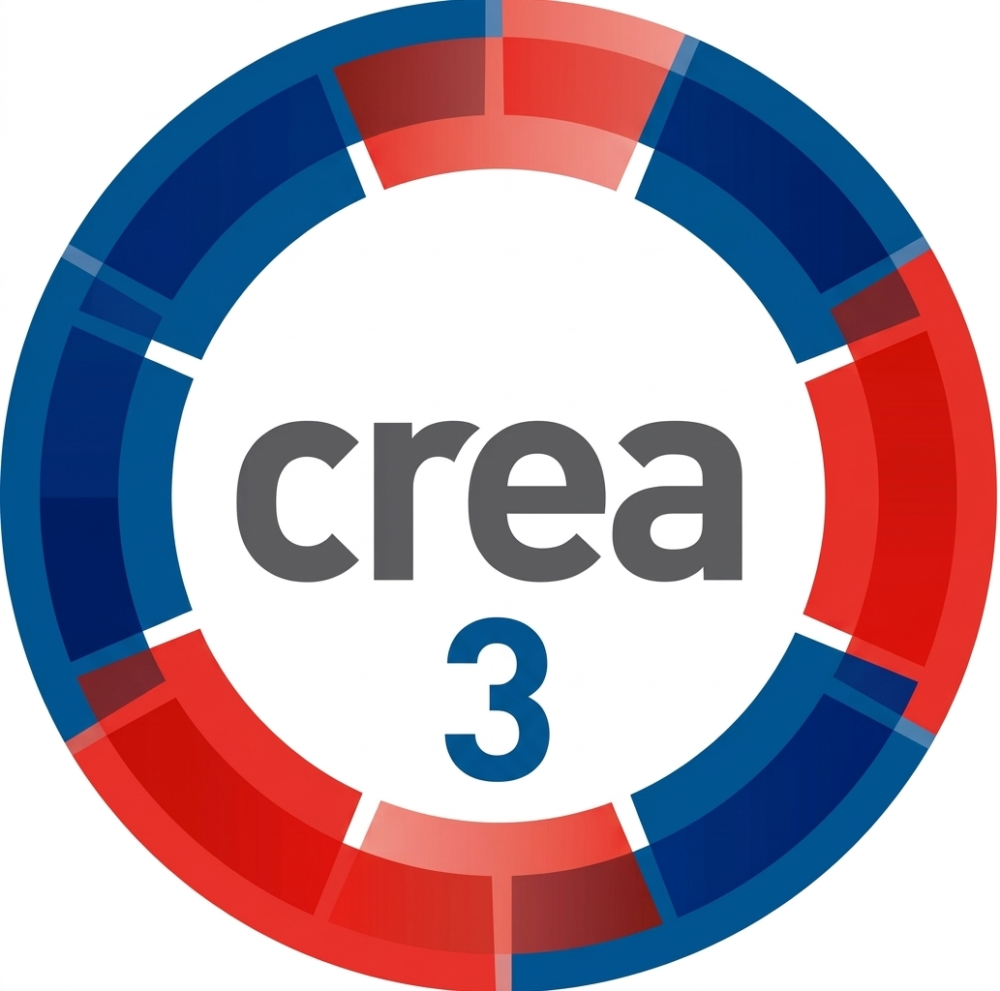

<div align="center">
  
  
  <p><strong>Examen Final de Programación Avanzada — 2.° Año Bachillerato Tecnológico en Informática (UTU)</strong><br>
  <strong>Docente:</strong> Matías Alfaro</p>
  <p><strong>Integrantes:</strong> Leandro Alonso, Leandro Marta y Valnetina Ferix</p>
  <p>
    
    
    
    
    
  </p>
</div>


Aplicación **web** (Java 17, Javalin 6 con Jetty embebido) para gestionar calificaciones, asistencias y tareas, con dos roles:
**Docente** (alta, modificación, baja y consulta) y **Estudiante** (consulta de sus propios datos).

## Tecnologías
Java 17 · Maven · Javalin 6 · HTML · MySQL 8 / MariaDB · BCrypt (jBCrypt) · Docker · Kubernetes (minikube) · Aiven (base en la nube) · Render / Railway (hosting con HTTPS)

## Estructura del repositorio
```
src/main/java/uy/edu/utu/crea3/
  model/      entidades (Usuario → Docente / Estudiante, Calificacion, Asistencia, Tarea)
  dao/        interfaces DAO + implementaciones JDBC (PreparedStatement)
  service/    interfaces de servicio + implementaciones (reglas, validación, permisos)
  web/        presentación web: WebServer (rutas), Vistas (HTML), Sesiones, Peticion
  config/     DatabaseConnection (variables de entorno) y AppContext (ensamblado)
  exception/  CreaException (excepción propia)
  util/       PasswordUtil (BCrypt), Validador
sql/          01-crear-tablas.sql, 02-datos-prueba.sql
k8s/          manifiestos de Kubernetes
docs/         guía de despliegue, informe de seguridad, diagramas
```

## Configuración
Todas las credenciales salen de variables de entorno. Copie `.env.example` a `.env` y complete los valores
(`.env` está en `.gitignore`):

| Variable | Descripción |
|---|---|
| `DB_HOST`, `DB_PORT`, `DB_NAME` | Dónde está la base (por defecto `localhost`, `3306`, `crea3_db`) |
| `DB_USER`, `DB_PASS` | Credenciales (obligatorias, no hay valores por defecto) |
| `DB_SSL_MODE` | `PREFERRED` en local, `REQUIRED` con Aiven |
| `PORT` | Puerto HTTP de la app (por defecto `8080`) |
| `DB_URL` | Opcional: URL JDBC completa (reemplaza a las anteriores) |

## Ejecución rápida
```bash
docker compose up --build        # base de datos + aplicación (ver docs/guia-despliegue.md)
```
Abrir http://localhost:8080 (health: http://localhost:8080/health).

Sin Docker (con una base MySQL ya cargada con `sql/`):
```bash
mvn clean package
./crea3                          # carga .env y ejecuta el jar
```
El puerto se toma de la variable `PORT` (Render la define); por defecto 8080.

## Usuarios de prueba
| Rol | Usuario | Contraseña |
|---|---|---|
| Docente | docente@utu.edu.uy | admin123 |
| Estudiante | estudiante@utu.edu.uy | admin123 |

No hay registro de usuarios en la aplicación: el alta es institucional, por la base de datos (`sql/02-datos-prueba.sql`),
porque la interfaz no puede validar si quien se registra es docente o estudiante.

## Requisitos mínimos (R1–R12) y dónde están en el código
| Req. | Dónde se cumple |
|---|---|
| R1 Modelo de datos | `sql/01-crear-tablas.sql` (tablas `usuario`, `materia`, `asistencia`, `calificacion`, `tarea`) |
| R2 CRUD | `CalificacionDAOImpl`, `AsistenciaDAOImpl`, `TareaDAOImpl` (alta, baja, modificación, consulta); páginas `/calificaciones`, `/asistencias`, `/tareas` (`web/WebServer`, `web/Vistas`) |
| R3 Usuarios y roles | `UsuarioDAOImpl.autenticar` + `PasswordUtil` (BCrypt); permisos en `PermisosUtil` y `Usuario.puedeGestionar()` |
| R4 Capas | `model` → `dao` (interfaces) → `service` (interfaces) → `web`; ensamblado en `AppContext` |
| R5 Orientación a objetos | `Usuario` (abstracta) → `Docente` / `Estudiante`; polimorfismo en `getRol()`, `puedeGestionar()`, `getTituloPanel()`; interfaces con implementación en DAO y servicios |
| R6 Consultas | Filtros: `CalificacionDAOImpl.buscar`, `AsistenciaDAOImpl.buscar`, `TareaDAOImpl.buscar`. JOIN con `materia`. Reportes: `promediosPorMateria` (COUNT, AVG, GROUP BY) y `contarPorEstado` (COUNT, GROUP BY) |
| R7 Transacción | `EvaluacionDAOImpl.registrarExamenConAsistencia` (inserta en `calificacion` y `asistencia` con commit/rollback) |
| R8 Validaciones y errores | `Validador`, `CreaException`; los DAO no muestran errores SQL al usuario (`CreaException.deDatos`) |
| R9 Consultas seguras | Todas las consultas usan `PreparedStatement` (los filtros dinámicos agregan solo texto fijo y parámetros `?`) |
| R10 Configuración externa | `DatabaseConnection` (variables de entorno) |
| R11 Datos de prueba | `sql/01-crear-tablas.sql` y `sql/02-datos-prueba.sql` |
| R12 Estado del servicio | `GET /health` en `WebServer.health` (200 si la app y la base funcionan, 503 si no) |

## Documentación
- [Guía de despliegue](docs/guia-despliegue.md)
- [Informe de seguridad](docs/informe-seguridad.md)
- [Diagrama de arquitectura](docs/diagramas/arquitectura.md)
